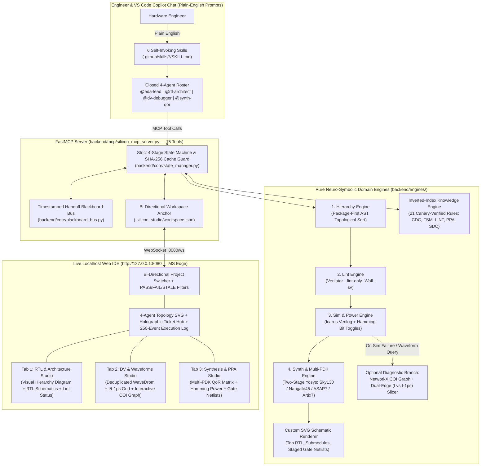
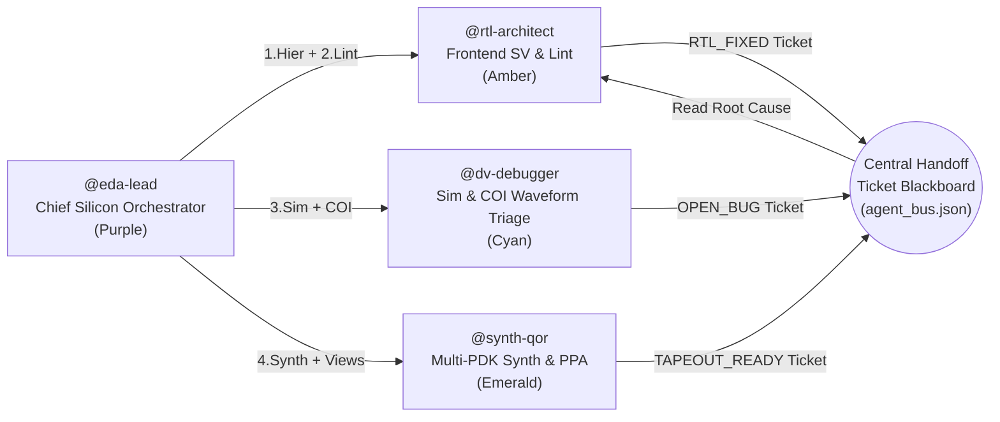
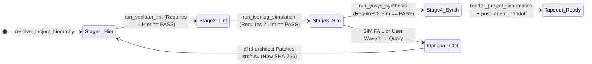
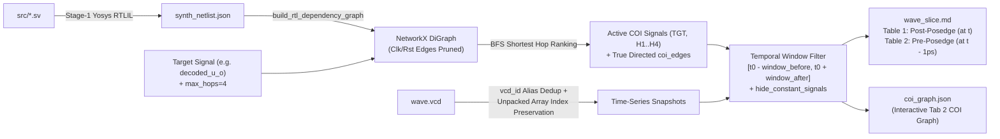

# Silicon Studio IDE V3.0 — Autonomous Neuro-Symbolic RTL-to-PPA Hardware Engineering Workbench

**Silicon Studio IDE V3.0** is a zero-copy, neuro-symbolic Electronic Design Automation (EDA) Integrated Development Environment and Multi-Agent Hardware Engineering Workbench. It bridges Large Language Model (LLM) reasoning with deterministic open-source silicon compilers (**Yosys**, **Verilator**, and **Icarus Verilog**), a **15-tool FastMCP Server** (`silicon-studio-mcp`), a **3-Tier Compiler-Canary Knowledge Base**, a **NetworkX Cone-of-Influence (COI) & Dual-Edge ($t$ vs. $t - 1\text{ ps}$) Waveform Slicer**, and a real-time **Localhost Web Studio (`http://127.0.0.1:8080`)**.

Engineers interact with the IDE in **plain, everyday English** while a closed roster of four specialized silicon agents (**`@eda-lead`**, **`@rtl-architect`**, **`@dv-debugger`**, and **`@synth-qor`**) and six self-invoking skills autonomously orchestrate RTL design, static lint closure, cycle-accurate simulation, structural COI root-cause bug triage, and multi-PDK ASIC/FPGA physical synthesis (**SkyWater 130nm**, **Nangate 45nm**, **ASAP7 7nm FinFET**, and **Xilinx Artix-7 FPGA**).

---

## Table of Contents

1. [Executive Summary & Core Innovations](#1-executive-summary--core-innovations)
2. [System Architecture & End-to-End Dataflow](#2-system-architecture--end-to-end-dataflow)
3. [Repository Structure: Tracked Source Files vs. Generated Runtime Artifacts](#3-repository-structure-tracked-source-files-vs-generated-runtime-artifacts)
4. [Prerequisites & 1-Click Installation Guide](#4-prerequisites--1-click-installation-guide)
5. [The Closed 4-Agent Roster & Natural-Language Intent Router](#5-the-closed-4-agent-roster--natural-language-intent-router)
6. [Self-Invoking Skills Library (`.github/skills/`)](#6-self-invoking-skills-library-githubskills)
7. [Strict 4-Stage Pipeline State Machine & SHA-256 Cache Invalidation](#7-strict-4-stage-pipeline-state-machine--sha-256-cache-invalidation)
8. [Neuro-Symbolic Cone-of-Influence (COI) & Dual-Edge ($t$ vs. $t - 1\text{ ps}$) Waveform Slicer](#8-neuro-symbolic-cone-of-influence-coi--dual-edge-t-vs-t---1-ps-waveform-slicer)
9. [Empirical Observability & Token-Compression Benchmarks](#9-empirical-observability--token-compression-benchmarks)
10. [3-Tier Compiler-Canary Knowledge Base & Agentic Pull-RAG](#10-3-tier-compiler-canary-knowledge-base--agentic-pull-rag)
11. [Two-Stage Yosys Synthesis, Multi-PDK Liberty Mapping & Toggle Power Engine](#11-two-stage-yosys-synthesis-multi-pdk-liberty-mapping--toggle-power-engine)
12. [Localhost Web IDE Dashboard (`http://127.0.0.1:8080`) Tour](#12-localhost-web-ide-dashboard-http1270018080-tour)
13. [Complete 15-Tool FastMCP Server Reference (`silicon-studio-mcp`)](#13-complete-15-tool-fastmcp-server-reference-silicon-studio-mcp)
14. [Reference Hardware Projects Included](#14-reference-hardware-projects-included)
15. [Step-by-Step Tutorial: Building & Verifying a New Project in Plain English](#15-step-by-step-tutorial-building--verifying-a-new-project-in-plain-english)
16. [Troubleshooting & FAQ](#16-troubleshooting--faq)

---

## 1. Executive Summary & Core Innovations

Traditional AI coding assistants struggle with hardware design (SystemVerilog/Verilog) due to five fundamental bottlenecks. Silicon Studio IDE V3.0 solves each bottleneck deterministically:

| Hardware AI Bottleneck | How Traditional LLMs Fail | Silicon Studio IDE V3.0 Solution |
| :--- | :--- | :--- |
| **1. Waveform Token Explosion** | Raw `.vcd` files or full cycle tables consume $30\text{k}\text{--}100\text{k}+$ tokens per simulation run, overflowing context windows and hiding root-cause transitions. | **Neuro-Symbolic COI + Dual-Edge ($t$ vs. $t - 1\text{ ps}$) Slicer** traces the exact structural Cone of Influence in `networkx` and slices only active causal signals around $t_0$, achieving **up to $+97.0\%$ token reduction vs. raw VCD** and **$+99.5\%$ vs. full tables**. |
| **2. Unverified RTL & CDC Hallucinations** | LLMs improvise broken Clock-Domain Crossing (CDC) synchronizers, infer unintended latches (`$dlatch`), or cause width truncations. | **3-Tier Compiler-Canary Knowledge Base (`Agentic Pull-RAG`)** validates 21 golden SystemVerilog/SDC rules against **Verilator `--lint-only -Wall`** and **Yosys `$dlatch` == 0** before indexing. Agents pull verified templates in ~220 tokens. |
| **3. Out-of-Order Tool Invocations & Stale State** | Agents run synthesis before simulation passes, or report stale QoR numbers after RTL edits. | **Strict 4-Stage Pipeline State Machine (`1.Hier -> 2.Lint -> 3.Sim -> 4.Synth`)** with **SHA-256 Cache Invalidation** blocks out-of-order tool calls (`BLOCKED_SEQUENCE_VIOLATION`) and automatically purges downstream artifacts and stale tickets when upstream stages re-run. |
| **4. Prompt Babysitting & Role Confusion** | Users must write long, technical prompts specifying tool names, flags, and file paths, or agents modify testbenches to fake a pass. | **Closed 4-Agent Roster + 6 Self-Invoking Skills** allow 1-sentence plain-English prompts while enforcing strict **Separation of Duties** (`@dv-debugger` is read-only on `src/`; `@rtl-architect` is forbidden from editing `verif/`). |
| **5. Blind CLI Execution** | Terminal-only MCP servers give zero visual feedback on module hierarchy, gate netlists, COI cones, or multi-PDK area scaling. | **Zero-Copy Live Web IDE (`:8080`)** with WebSocket synchronization, interactive pan/zoom RTL & Gate schematics, Visual Module Hierarchy diagrams, glowing COI dependency graphs, and WaveDrom timing studios. |

---

## 2. System Architecture & End-to-End Dataflow



---

## 3. Repository Structure: Tracked Source Files vs. Generated Runtime Artifacts

When cloning or uploading **Silicon Studio IDE V3.0** to GitHub, the repository is cleanly divided between **tracked source files** (committed to Git) and **generated runtime/bootstrap files** (automatically built by `scripts/bootstrap.ps1` or created inside `projects/<name>/build/` during tool runs and ignored via `.gitignore`).

### 3.1 Tracked Repository Tree (Committed to GitHub)

```text
silicon-studio-ide/
├── .github/
│   ├── agents/                              # Closed 4-Agent Persona Definitions
│   │   ├── dv-debugger.agent.md             # @dv-debugger (Read-only on src/, owns Sim & COI)
│   │   ├── eda-lead.agent.md                # @eda-lead (Chief Silicon Orchestrator)
│   │   ├── rtl-architect.agent.md           # @rtl-architect (Owns src/*.sv, Hierarchy & Lint)
│   │   └── synth-qor.agent.md               # @synth-qor (Owns Multi-PDK Synthesis & Schematics)
│   ├── skills/                              # 6 Self-Invoking Plain-English Skills
│   │   ├── dv-sim-signoff/SKILL.md
│   │   ├── full-tapeout-flow/SKILL.md
│   │   ├── rtl-lint-signoff/SKILL.md
│   │   ├── scaffold-new-project/SKILL.md
│   │   ├── synth-ppa-closure/SKILL.md
│   │   └── triage-and-fix-bug/SKILL.md
│   └── copilot-instructions.md              # System Constitution & Plain-English Intent Router
├── .silicon_studio/
│   └── studio_config.json                   # Global Server (:8080), Toolchain & PDK Configuration
├── .vscode/
│   ├── settings.json                        # Python Venv & Copilot Instruction/Prompt bindings
│   └── tasks.json                           # Auto-Start Server & Auto-Launch MS Edge on Folder Open
├── backend/
│   ├── __init__.py
│   ├── core/
│   │   ├── __init__.py
│   │   ├── blackboard_bus.py                # Timestamped, Cache-Synced Handoff Ticket Manager
│   │   ├── executor.py                      # Deterministic Subprocess Harness for OSS CAD Suite
│   │   ├── state_manager.py                 # 4-Stage Pipeline State Machine & SHA-256 Invalidator
│   │   └── workspace_manager.py             # Bi-Directional Project Context & Atomic JSON I/O
│   ├── engines/
│   │   ├── __init__.py
│   │   ├── coi_slicer_engine.py             # NetworkX COI Subgraph & Dual-Edge (t vs t-1ps) Slicer
│   │   ├── hierarchy_engine.py              # Package-First SystemVerilog AST Topological Resolver
│   │   ├── knowledge_engine.py              # Weighted Inverted-Index Pull-RAG Engine
│   │   ├── lint_engine.py                   # Verilator Static Lint Engine (--lint-only -Wall -sv)
│   │   ├── pass_state_validator.py          # Yosys Pass Ordering & Capability Schema Validator
│   │   ├── schematic_engine.py              # Custom Multi-Column SVG Schematic & Netlist Renderer
│   │   ├── sim_engine.py                    # Icarus Verilog Simulator & Hamming Power Analyzer
│   │   └── synth_engine.py                  # Two-Stage Yosys ASIC Liberty & FPGA Synthesis Engine
│   ├── mcp/
│   │   ├── __init__.py
│   │   └── silicon_mcp_server.py            # 15-Tool FastMCP Server
│   └── server/
│       ├── __init__.py
│       ├── api_routes.py                    # FastAPI REST Endpoints (/api/bundle, /api/projects)
│       └── studio_server.py                 # Uvicorn + Watchdog Live WebSocket Server (:8080)
├── docs/
│   └── manuals/
│       ├── ablation_benchmark_results.md    # Empirical COI Token-Compression & KB Benchmark Report
│       └── master_stress_test_playbook.md   # 24-Prompt Sequential Stress-Test Playbook
├── frontend/
│   ├── css/
│   │   └── obsidian_theme.css               # Obsidian Dark & High-Contrast Silicon Daylight Themes
│   ├── js/
│   │   ├── components/
│   │   │   ├── navbar.js                    # Project Dropdown, SHA Badge & 4-Stage Pipeline Bar
│   │   │   ├── tab_dv_studio.js             # WaveDrom, Dual-Edge Grid & Interactive COI Graph
│   │   │   ├── tab_rtl_studio.js            # Lint Status, Visual Hierarchy SVG & RTL Schematics
│   │   │   ├── tab_synth_studio.js          # Multi-PDK QoR Matrix, Toggle Power & Gate Schematics
│   │   │   ├── telemetry_log.js             # 250-Event Project-Scoped Execution Log Table
│   │   │   ├── ticket_drawer.js             # Timestamped Slide-Over Handoff Blackboard Drawer
│   │   │   └── topology_graph.js            # 4-Agent SVG Topology & Holographic Ticket Stack
│   │   ├── app.js                           # WebSocket Client, REST Fallback & Tab Controller
│   │   ├── pan_zoom_engine.js               # Cursor-Focal Pan/Zoom & Horizontal Time-Scale Engine
│   │   └── store.js                         # Reactive State Store & Ticket Cache-Sync Filter
│   └── index.html                           # Single-Page Web IDE Application Shell
├── pdk_lib/                                 # Open-Source Standard Cell Liberty (.lib) Libraries
│   ├── asap7/                               # 7nm ASAP7 Predictive FinFET RVT Liberty Files
│   │   ├── asap7sc7p5t_INVBUF_RVT_TT_nldm_220122.lib
│   │   ├── asap7sc7p5t_SEQ_RVT_TT_nldm_220123.lib
│   │   └── asap7sc7p5t_SIMPLE_RVT_TT_nldm_211120.lib
│   ├── nangate45/                           # 45nm Nangate Open Cell Library
│   │   └── NangateOpenCellLibrary_typical.lib
│   └── sky130_fd_sc_hd/                     # 130nm SkyWater High-Density Standard Cell Library
│       └── sky130_fd_sc_hd__tt_025C_1v80.lib
├── projects/                                # Reference Hardware Projects (src/ and verif/ tracked)
│   ├── async_fifo/
│   │   ├── src/async_fifo.sv
│   │   └── verif/tb_async_fifo.sv
│   ├── polar_scl_decoder/
│   │   ├── model/scl_golden_model.py
│   │   ├── src/
│   │   │   ├── scl_pkg.sv
│   │   │   ├── pe_unit.sv
│   │   │   ├── sc_core.sv
│   │   │   ├── metric_sorter.sv
│   │   │   └── polar_scl_top.sv
│   │   └── verif/
│   │       ├── tb_polar_scl.sv
│   │       ├── tv_channel_llrs.mem
│   │       └── tv_expected_u.mem
│   └── programmable_pwm_timer/
│       ├── src/programmable_pwm_timer.sv
│       └── verif/tb_programmable_pwm_timer.sv
├── schema_factory/                          # Offline Introspection & 3-Tier Canary Schema Builder
│   ├── __init__.py
│   ├── build_all_schemas.py                 # Master CLI Builder (invoked by scripts/bootstrap.ps1)
│   ├── knowledge_factory/
│   │   ├── __init__.py
│   │   ├── build_knowledge_schema.py        # Runs Verilator + Yosys Canary Gate on all 21 KB Rules
│   │   ├── mine_kb_candidates.py
│   │   ├── corpus/                          # Reference SV/PDF/RST Hardware Design Corpus
│   │   └── staging/candidate_rules_batch.json
│   └── tool_introspector/
│       ├── __init__.py
│       ├── base_introspector.py
│       ├── iverilog_introspector.py
│       ├── verilator_introspector.py
│       └── yosys_introspector.py
├── scripts/
│   ├── bootstrap.ps1                        # 1-Click Venv Setup, Pip Install & Schema Builder
│   ├── run_ablation_benchmarks.py           # Empirical COI Token-Compression Benchmark Runner
│   └── start_studio.ps1                     # Launches Server (:8080) & Opens MS Edge
├── .gitignore                               # Excludes .venv/, build/, __pycache__/, and OS files
├── .mcp.json                                # Registers silicon-studio-mcp with VS Code Copilot
└── README.md                                # This Comprehensive Manual
```

### 3.2 Generated Files & Directories (Created Automatically — Not Required Before Cloning)

| Generated Path | Created By | Purpose |
| :--- | :--- | :--- |
| `.venv/` | `scripts/bootstrap.ps1` | Local Python virtual environment (`fastmcp`, `fastapi`, `uvicorn`, `websockets`, `watchdog`, `networkx`). |
| `schemas/` (`knowledge/`, `lint/`, `simulation/`, `synthesis/`, `tools/`, `registry_index.json`) | `scripts/bootstrap.ps1` (`build_all_schemas.py`) | Deterministic compiler capability schemas and the 21 canary-validated knowledge base rule JSONs. |
| `docs/manuals/*_capabilities.md` & `silicon_kb_catalog.md` | `scripts/bootstrap.ps1` (`build_all_schemas.py`) | Auto-generated human-readable Markdown catalogs of tool flags and KB rules. |
| `.silicon_studio/workspace.json` | `workspace_manager.py` | Runtime anchor tracking the currently selected `active_project` and `rtl_sha256`. |
| `projects/<name>/build/agent_bus/` | Runtime MCP Tool Calls | `session_state.json`, `tool_history.json`, `hierarchy.json`, `agent_bus.json`, `active_ticket.md`. |
| `projects/<name>/build/simulation/` | `run_iverilog_simulation` & `read_coi_sliced_waveform` | `wave.vcd`, `wave_full.md`, `wave_slice.md`, `wave_slice_diagnostic.md`, `coi_graph.json`, `wavedrom_*.json`. |
| `projects/<name>/build/netlists/` | `run_yosys_synthesis` & `ensure_rtlil_elaboration_for_coi` | `synth_netlist.json` (Stage-1 RTLIL) and `mapped_<target>/synth_gates.{v,json}` (Stage-2 gate netlists). |
| `projects/<name>/build/reports/` | Lint / Sim / Synth Engines | `lint_report.txt`, `sim_report.txt`, `power_activity.json`, `synth_qor_<target>.json`, `ppa_comparison_matrix.md`. |
| `projects/<name>/build/views/` | `render_project_schematics` | `schematic_rtl.svg`, `schematic_<submod>.svg`, and `schematic_gates_<target>.svg`. |

---

## 4. Prerequisites & 1-Click Installation Guide

### 4.1 System Prerequisites
1. **Operating System:** Windows 10 / 11 (PowerShell 5.1+ or PowerShell 7+).
2. **Python:** Python 3.10+ installed and available on `PATH`.
3. **YosysHQ OSS CAD Suite:** Installed at `C:\oss-cad-suite` (or available on system `PATH`), providing:
   - `yosys.exe` (RTLIL elaboration, `$dlatch` audit, ASIC Liberty & FPGA synthesis)
   - `verilator_bin.exe` (Static IEEE 1800-2012 lint checking)
   - `iverilog.exe` & `vvp.exe` (Dynamic cycle-accurate simulation & VCD generation)
4. **VS Code + GitHub Copilot Chat Extension:** With MCP support enabled.

### 4.2 Step 1 — Clone the Repository & Run 1-Click Bootstrap
Open PowerShell in the repository root and run `bootstrap.ps1`:

```powershell
git clone https://github.com/<your-username>/silicon-studio-ide.git
cd silicon-studio-ide
powershell -ExecutionPolicy Bypass -File .\scripts\bootstrap.ps1
```

**What `bootstrap.ps1` does automatically in 4 steps:**
1. **`[1/4]`** Creates `.venv` (or reuses it if already present).
2. **`[2/4]`** Installs `fastmcp`, `fastapi`, `uvicorn`, `websockets`, `watchdog`, and `networkx`.
3. **`[3/4]`** Verifies `C:\oss-cad-suite\bin` binaries (`yosys`, `verilator_bin`, `iverilog`).
4. **`[4/4]`** Runs `python -m schema_factory.build_all_schemas --all`, introspecting your local EDA binaries and executing the **3-Tier Verilator + Yosys Compiler-Canary Gate** across all 21 silicon design rules to populate `schemas/` and `docs/manuals/`.

### 4.3 Step 2 — Launch the Live Localhost Web IDE (`:8080`) in Microsoft Edge
Either open the folder in VS Code (which automatically triggers the `folderOpen` tasks in `.vscode/tasks.json` to start the server and open Microsoft Edge), or run:

```powershell
powershell -ExecutionPolicy Bypass -File .\scripts\start_studio.ps1
```

This launches the FastAPI + Watchdog WebSocket server on **`http://127.0.0.1:8080`** and opens the dashboard directly in **Microsoft Edge**.

---

## 5. The Closed 4-Agent Roster & Natural-Language Intent Router

To prevent LLM hallucination, **Silicon Studio IDE V3.0** enforces a **Closed 4-Agent Roster** defined in `.github/copilot-instructions.md` and `.github/agents/*.agent.md`. The AI is strictly forbidden from inventing fake agent personas.



### 5.1 Agent Roles & Separation-of-Duties Guardrails

| Agent Handle | File Path | Core Responsibilities | Strict Guardrails |
| :--- | :--- | :--- | :--- |
| **`@eda-lead`** | `.github/agents/eda-lead.agent.md` | Chief Silicon Orchestrator. Syncs workspace context, dispatches `@rtl-architect` $\rightarrow$ `@dv-debugger` $\rightarrow$ `@synth-qor` across the 4-stage pipeline, and presents executive sign-off tables. | Never skips pipeline stages; enforces closed 4-agent roster in all handoffs. |
| **`@rtl-architect`** | `.github/agents/rtl-architect.agent.md` | Principal Frontend SystemVerilog Engineer. Owns `projects/*/src/*.sv`, package-first hierarchy (`1.Hier`), Verilator static lint (`2.Lint`), and Agentic Pull-RAG template application. | **FORBIDDEN from editing `verif/tb_*.sv` or `.mem` vectors** to make a failing test pass. Must pull KB rules before patching RTL. |
| **`@dv-debugger`** | `.github/agents/dv-debugger.agent.md` | Staff Verification & Waveform Investigator. Owns Icarus simulation (`3.Sim`), COI subgraph extraction, Dual-Edge ($t$ vs. $t - 1\text{ ps}$) waveform slicing, and `OPEN_BUG` ticket creation. | **STRICTLY READ-ONLY on `src/*.sv`** and **FORBIDDEN from calling `read_waveform` during COI triage**. |
| **`@synth-qor`** | `.github/agents/synth-qor.agent.md` | Principal Physical Implementation Engineer. Owns two-stage Yosys synthesis (`4.Synth`) across `sky130`, `nangate45`, `asap7`, and `artix7`, SDC/PPA KB lookups, and SVG schematic rendering. | Cannot execute Stage 4 unless Stages `1.Hier`, `2.Lint`, and `3.Sim` are all `PASS` on the current `rtl_sha256`. |

### 5.2 Plain-English Intent Router (Zero-Boilerplate Prompting)
You never need to type long technical prompts or remember MCP tool names. The system constitution automatically translates casual English into deterministic tool sequences:

- *"Check the RTL and lint this project"* $\rightarrow$ Invokes **`@rtl-architect`**: `resolve_project_hierarchy` (`1.Hier`) $\rightarrow$ `run_verilator_lint` (`2.Lint`).
- *"Simulate the active project"* $\rightarrow$ Invokes **`@dv-debugger`**: Ensures `1.Hier` & `2.Lint` are `PASS` $\rightarrow$ `run_iverilog_simulation` (`3.Sim`).
- *"Why did simulation fail? Triage and fix it"* $\rightarrow$ Invokes **`@dv-debugger` $\rightarrow$ `@rtl-architect`**: `extract_backward_coi` $\rightarrow$ `read_coi_sliced_waveform` $\rightarrow$ `query_design_knowledge` $\rightarrow$ `post_agent_handoff(OPEN_BUG)` $\rightarrow$ RTL patch $\rightarrow$ `1.Hier -> 2.Lint -> 3.Sim`.
- *"Synthesize across all PDKs and render schematics"* $\rightarrow$ Invokes **`@synth-qor`**: `query_design_knowledge(ppa/sdc)` $\rightarrow$ `run_yosys_synthesis` (`sky130`, `nangate45`, `asap7`) $\rightarrow$ `render_project_schematics` $\rightarrow$ `post_agent_handoff(TAPEOUT_READY)`.
- *"Run the full tapeout flow"* $\rightarrow$ Invokes **`@eda-lead`**: Autonomously executes all 4 stages (`1.Hier -> 2.Lint -> 3.Sim -> 4.Synth`) to `TAPEOUT_READY`.

---

## 6. Self-Invoking Skills Library (`.github/skills/`)

All six skills in `.github/skills/*/SKILL.md` are configured with **`disable-model-invocation: false`**, allowing GitHub Copilot to self-invoke them from natural-language requests or via `/skill-name`:

| Skill Name | Path | Natural-Language Trigger Examples | Autonomous Execution Pipeline |
| :--- | :--- | :--- | :--- |
| **`full-tapeout-flow`** | `.github/skills/full-tapeout-flow/SKILL.md` | *"Run the full tapeout flow on `polar_scl_decoder`"* | `1.Hier` $\rightarrow$ `2.Lint` (with auto-fix) $\rightarrow$ `3.Sim` (with COI triage if failing) $\rightarrow$ `4.Synth` (`sky130`, `nangate45`, `asap7`) $\rightarrow$ `render_project_schematics` $\rightarrow$ `TAPEOUT_READY` ticket. |
| **`triage-and-fix-bug`** | `.github/skills/triage-and-fix-bug/SKILL.md` | *"Triage and fix the failing simulation bug"* | Reproduces failure $\rightarrow$ 4-signal Control Roadmap $\rightarrow$ Backward COI + Dual-Edge ($t$ vs. $t - 1\text{ ps}$) slice $\rightarrow$ Pull-RAG lookup $\rightarrow$ `OPEN_BUG` ticket $\rightarrow$ surgical RTL fix $\rightarrow$ regression sign-off. |
| **`rtl-lint-signoff`** | `.github/skills/rtl-lint-signoff/SKILL.md` | *"Check hierarchy and Verilator lint"* | Runs `resolve_project_hierarchy` (`1.Hier`) $\rightarrow$ `run_verilator_lint` (`2.Lint`) $\rightarrow$ auto-remediates any warnings via `query_design_knowledge(domain="lint")`. |
| **`dv-sim-signoff`** | `.github/skills/dv-sim-signoff/SKILL.md` | *"Simulate the design and check switching power"* | Verifies `1.Hier` & `2.Lint` prerequisites $\rightarrow$ runs `run_iverilog_simulation` (`3.Sim`) $\rightarrow$ reports cycle count, X/Z audit, and Hamming bit toggles. |
| **`synth-ppa-closure`** | `.github/skills/synth-ppa-closure/SKILL.md` | *"Synthesize across all ASIC PDKs and generate schematics"* | Verifies `1.Hier`, `2.Lint`, `3.Sim` $\rightarrow$ pulls `ppa`/`sdc` KB rule $\rightarrow$ synthesizes `sky130`, `nangate45`, `asap7` $\rightarrow$ renders all SVGs $\rightarrow$ posts `TAPEOUT_READY`. |
| **`scaffold-new-project`** | `.github/skills/scaffold-new-project/SKILL.md` | *"Design a programmable PWM timer in our active project"* | Pulls golden `fsm`/`lint` rules $\rightarrow$ writes synthesizable `src/<mod>.sv` & self-checking `verif/tb_<mod>.sv` $\rightarrow$ runs `1.Hier` + `2.Lint` to 0 warnings. |

---

## 7. Strict 4-Stage Pipeline State Machine & SHA-256 Cache Invalidation

### 7.1 Mandatory Sequential Order (`1.Hier -> 2.Lint -> 3.Sim -> 4.Synth`)
Implemented in `backend/core/state_manager.py`, the IDE enforces a strict 4-stage state machine:



1. **Precondition Gate (`check_stage_preconditions`):**
   - Attempting to call `run_verilator_lint` before `1.Hier` is complete, `run_iverilog_simulation` while `2.Lint` is `FAIL`/`STALE`/`PENDING`, or `run_yosys_synthesis` before `3.Sim` is `PASS` immediately returns a structured **`BLOCKED_SEQUENCE_VIOLATION`** response guiding the agent to the exact missing prerequisite.
2. **Optional Diagnostic COI Exception (`🔍 COI`):**
   - Step **`🔍 COI`** (`extract_backward_coi` and `read_coi_sliced_waveform`) is **decoupled from mandatory sequence gating**.
   - When `3.Sim` passes cleanly, `4.Synth` executes directly without requiring COI.
   - When `3.Sim` fails (or when an engineer requests waveform inspection), `ensure_rtlil_elaboration_for_coi()` elaborates *only* the Stage-1 word-level RTLIL (`build/netlists/synth_netlist.json`) without running gate synthesis or falsely marking `4.Synth` as `PASS`.

### 7.2 Cascading Downstream Invalidation & Ticket Pool Synchronization
Every project's `src/` (`*.sv`, `*.v`, `*.vh`) and `verif/` (`*.sv`, `*.mem`) directories are continuously Fingerprinted with a deterministic 16-character **SHA-256 digest**:

- **File Edit Invalidation:** When `StudioWorkspaceWatcher` (`watchdog`) or an MCP tool detects a change in `src/*.sv`, `validate_and_invalidate_cache()` immediately marks `lint`, `simulation`, and `synthesis` as **`STALE`**, physically deletes outdated reports/netlists/VCDs from `build/`, and logs a `STALE` event in the Execution Log.
- **Stage Re-Run Cascading (`invalidate_downstream_stages`):** Re-running an earlier stage (e.g., `resolve_project_hierarchy`) automatically invalidates all downstream stages (`2.Lint`, `3.Sim`, `4.Synth` $\rightarrow$ `STALE`) even if the source SHA-256 has not changed.
- **Cache-Synced Ticket Pool (`_prune_stale_tickets_on_disk` & `filterLiveProjectTickets`):**
  - A `TAPEOUT_READY` ticket is **only** valid while `synthesis` is in `completed_stages` (and not `stale`). If `1.Hier` is re-run, any previous session's `TAPEOUT_READY` ticket is immediately purged so stale tickets never linger during a new run.
  - Once a bug is fixed in `src/*.sv` and `simulation` passes on the new `rtl_sha256`, any prior `OPEN_BUG` ticket is automatically resolved and purged so only live tickets remain in the Blackboard stack.

---

## 8. Neuro-Symbolic Cone-of-Influence (COI) & Dual-Edge ($t$ vs. $t - 1\text{ ps}$) Waveform Slicer

Located in `backend/engines/coi_slicer_engine.py`, the Neuro-Symbolic Slicer eliminates the need for LLMs to read raw VCD files.



### 8.1 How Structural COI Tracing Works
1. **Multi-Module Directed Dependency Graph (`build_rtl_dependency_graph`):**
   - Parses Yosys `synth_netlist.json` across the top module and all child submodule instances (`u_sc_core`, `u_metric_sorter`, `gen_pe_array[*].u_pe`).
   - Tags every public net driven by a sequential cell (`$dff`, `$dffe`, `$adff`, `$sdff`, `$dlatch`) with **`is_seq = True`** so the UI and agent know with 100% certainty which signals are sequential flip-flops vs. combinational wires.
   - **Clock & Reset Pruning:** Automatically disconnects `CLK`, `RST`, and `RST_N` pins during graph traversal so tracing backward from a flip-flop follows its **data (`D`) and enable (`EN`)** cone rather than branching through the global clock tree to every register on the chip.
2. **Logical Hop Counting (`TGT`, `H1`, `H2`, `H3`, `H4`):**
   - Each step across a hardware cell increments the hop counter:
     $$\text{Logical Hops} = \text{Combinational Cell Hops} + \text{Sequential FF Hops}$$
   - Signals within `max_hops` (default `4`) are ranked by `(logical_hops, sequential_depth_cycles)` and capped to the highest-priority causal signals (`max_signals_cap = 16`).
3. **True Hardware Edge Extraction (`_extract_public_signal_edges`):**
   - Collapses intermediate `:bit_X` netlist nodes via Breadth-First Search (BFS) into direct `source_signal -> target_signal` edges (`coi_edges` and `background_edges`) saved to `build/simulation/coi_graph.json`.

### 8.2 VCD Alias Deduplication & Unpacked Array Preservation
- **Shared `vcd_id` Alias Deduplication:** In Icarus Verilog VCD dumps, a testbench wire (`tb_polar_scl.decoded_u_o`) and the DUT port it connects to (`tb_polar_scl.u_dut.decoded_u_o`) share the exact same single-character VCD identifier (`vcd_id`). `_parse_vcd()` deduplicates shared `vcd_id`s—preferring the DUT scope—so signals never appear twice in WaveDrom or Markdown tables.
- **Unpacked Array Index Preservation (`_strip_bit_range_preserve_array_index`):** Strips bit-range slices (`best_pm_o[7:0]` $\rightarrow$ `best_pm_o`) while preserving single-element unpacked array indices (`pm_reg[0]`, `pm_reg[1]`, `path_mem[0]`). If Icarus Verilog `$dumpvars(0, tb)` omits an unpacked SystemVerilog array from `wave.vcd`, the slicer automatically includes its packed concatenation bus (`pm_in_packed`, `sorted_pm`) and emits an `unpacked_array_proxy_note`.

### 8.3 Dual-Edge ($t$ vs. $t - 1\text{ ps}$) Setup & Hold Disambiguation
In `build/simulation/wave_slice.md`, every slice generates two synchronized tables around anchor timestamp $t_0$:
1. **Table 1 — Post-Posedge Registered State (`at t`):** Shows the values latched into sequential flip-flops immediately *after* the clock edge at $t_0$.
2. **Table 2 — Pre-Posedge Combinational Setup (`at t - 1ps`):** Samples the exact same signals $1\text{ ps}$ *before* the clock edge ($t_0 - 1\text{ ps}$), exposing the exact combinational next-state inputs waiting at the flip-flop $D$-pins just before the clock edge hit.
   - **Diagnostic Rule:** If the combinational signal at $t_0 - 1\text{ ps}$ is already wrong $\rightarrow$ **Combinational datapath bug**. If the combinational value at $t_0 - 1\text{ ps}$ is right, but the register at $t_0$ latched the wrong value $\rightarrow$ **Sequential FSM enable/reset/CDC bug**.

---

## 9. Empirical Observability & Token-Compression Benchmarks

Executed via `python .\scripts\run_ablation_benchmarks.py` (`docs/manuals/ablation_benchmark_results.md`), the Neuro-Symbolic COI + Dual-Edge Slicer achieves massive token compression across all three reference projects:

### 9.1 Neuro-Symbolic COI + Dual-Edge ($t$ vs. $t - 1\text{ ps}$) Token Compression

| Project | Raw VCD (`wave.vcd`) | Full Table (`wave_full.md`) | COI Slice (`wave_slice.md`) | Reduction vs. Raw VCD | Reduction vs. Full Table | Signals (VCD $\rightarrow$ COI) | Sign-Off Status |
| :--- | ---: | ---: | ---: | ---: | ---: | :---: | :--- |
| **`async_fifo`** | $7,937\text{ tok}$ ($31,750\text{ c}$) | $96,523\text{ tok}$ ($386,094\text{ c}$) | **$436\text{ tok}$** ($1,746\text{ c}$) | **$+94.5\%$** | **$+99.5\%$** | `51 -> 10` | `TAPEOUT_READY` |
| **`polar_scl_decoder`** | $8,390\text{ tok}$ ($33,561\text{ c}$) | $33,509\text{ tok}$ ($134,037\text{ c}$) | **$254\text{ tok}$** ($1,018\text{ c}$) | **$+97.0\%$** | **$+99.2\%$** | `270 -> 5` | `TAPEOUT_READY` |
| **`programmable_pwm_timer`** | $525\text{ tok}$ ($2,103\text{ c}$) | $2,700\text{ tok}$ ($10,801\text{ c}$) | **$369\text{ tok}$** ($1,478\text{ c}$) | **$+29.7\%$** | **$+86.3\%$** | `21 -> 9` | `TAPEOUT_READY` |

---

## 10. 3-Tier Compiler-Canary Knowledge Base & Agentic Pull-RAG

Unlike static text RAG systems that feed unverified code snippets to LLMs, Silicon Studio IDE V3.0 compiles and verifies every single rule in its knowledge base (`schema_factory/knowledge_factory/build_knowledge_schema.py`) before any agent is allowed to use it.

### 10.1 The 3-Tier Compiler-Canary Gate
During `bootstrap.ps1`, each of the 21 candidate rules in `schemas/knowledge/rules/*.json` is wrapped in a self-contained canary module and subjected to three hardware gates:
- **Tier 1 — Verilator Static Lint Gate (`verilator_bin --lint-only -Wall -sv`):** Must exit with code `0` and `0 warnings`.
- **Tier 2 — Yosys Structural & Latch Audit (`yosys -p "read_verilog -sv ...; proc; opt; stat"`):** Must elaborate cleanly with **zero inferred latches (`$dlatch == 0`)**.
- **Tier 3 — Runtime Payload Stripping (`knowledge_engine.py`):** When an agent calls `query_design_knowledge(domain, symptom_or_pattern, project_name)`, the engine scores rules via an in-memory weighted inverted index (`rule_id`: $+8.0$, `tags`: $+4.0$, `symptom_patterns`: $+2.5$, `description`: $+1.0$) and strips the heavy build-time `canary_spec` wrapper—returning only the compact `golden_template` (**~220 tokens per pull**).

### 10.2 Complete Catalog of 21 Canary-Verified Silicon Rules

| Domain | Verified Count | Rule IDs & Engineering Coverage | Validation Gate |
| :--- | :---: | :--- | :--- |
| **`CDC`** | **4** | `CDC-001-PULSE-SWALLOW` (Toggle + 2-FF pulse sync), `CDC-002-GRAY-FIFO-PTR` (Binary-to-Gray FIFO pointers), `CDC-003-REQ-ACK-HANDSHAKE` (4-phase handshake), `CDC-004-SYNC-CONVERGENCE` (Multi-bit bus reconvergence prevention) | Verilator `-Wall` + Yosys `$dlatch == 0` |
| **`FSM`** | **4** | `FSM-001-SAFE-RECOVERY` (SEU `default: state_d = ST_IDLE`), `FSM-002-MEALY-GLITCH-OUT` (Registered glitch-free outputs), `FSM-003-TWO-BLOCK-STYLE` (Explicit `state_q` / `state_d` separation), `FSM-004-ONEHOT-DECODE` (Safe one-hot synthesis attributes) | Verilator `-Wall` + Yosys `$dlatch == 0` |
| **`LINT`** | **6** | `LINT-001-INFERRED-LATCH` (Upfront `always_comb` defaults), `LINT-002-WIDTH-TRUNC` (Explicit `WIDTH'(expr)` casts), `LINT-003-COMB-LOOP` (Zero-delay loop breaking), `LINT-004-BLKSEQ-ASSIGN` (Strict `<=` in `always_ff`), `LINT-005-CASE-OVERLAP` (`unique casez` priority), `LINT-006-UNUSED-SIGNAL` (Clean unused net handling) | Verilator `-Wall` + Yosys `$dlatch == 0` |
| **`PPA`** | **4** | `PPA-001-CRITICAL-PATH-LTP` (Balanced tree reduction for `ltp -noff`), `PPA-002-ARITH-RESOURCE-SHARE` (Pre-muxing shared adders/comparators), `PPA-003-BITWIDTH-TRIMMING` (Tight accumulator sizing), `PPA-004-DYNAMIC-TOGGLE-GATE` (Operand isolation & clock-enable gating) | Verilator `-Wall` + Yosys `$dlatch == 0` |
| **`SDC`** | **3** | `SDC-001-ASYNC-CLK-GROUPS` (`set_clock_groups -asynchronous`), `SDC-002-MAX-DELAY-GRAY` (`set_max_delay -datapath_only` on Gray pointers), `SDC-003-IO-DELAY-BUDGET` (`set_input_delay` / `set_output_delay` boundary budgets) | OpenSTA / SDC Syntax + Canary Gate |

---

## 11. Two-Stage Yosys Synthesis, Multi-PDK Liberty Mapping & Toggle Power Engine

Implemented in `backend/engines/synth_engine.py`, Stage 4 executes a deterministic **Two-Stage Yosys Synthesis Pipeline** into isolated per-target directories (`projects/<name>/build/netlists/mapped_<target>/`):

1. **Stage 1 — Word-Level RTLIL Elaboration (`synth_netlist.json`):**
   - Runs `read_verilog -sv <ordered_files>; hierarchy -check -top <rtl_top>; proc; opt; fsm; opt; memory; opt; write_json synth_netlist.json`.
   - Preserves word-level blocks (`$add`, `$mux`, `$dff`, submodule instances) for Tab 1 RTL schematics and COI dependency tracing.
2. **Stage 2 — Technology Mapping (`synth_gates.v` & `synth_gates.json`):**
   - **ASIC Liberty Mode (`synth_mode="asic_liberty"`):** Runs `flatten; opt; techmap; simplemap; opt; dfflibmap -liberty <lib>; abc -liberty <merged_comb_lib>; opt_clean -purge; stat -liberty <lib>; ltp -noff`.
     - Automatically merges multi-file Liberty libraries (such as **ASAP7 7nm** `INVBUF` + `SIMPLE` + `SEQ` `.lib` files) so ABC combinational mapping and `dfflibmap` sequential mapping succeed seamlessly.
     - Supported built-in ASIC PDKs in `pdk_lib/`:
       - **`sky130`**: SkyWater 130nm HD (`sky130_fd_sc_hd__tt_025C_1v80.lib`)
       - **`nangate45`**: Nangate 45nm Open Cell Library (`NangateOpenCellLibrary_typical.lib`)
       - **`asap7`**: ASAP7 7nm Predictive FinFET RVT (`asap7sc7p5t_*_RVT_TT_nldm_*.lib`)
   - **FPGA Mode (`synth_mode="fpga"`):** Supports `artix7` / `basys3` (`synth_xilinx -family xc7`), `ice40` (`synth_ice40`), `ecp5` (`synth_ecp5`), and `cyclonev`.
   - **Multi-PDK PPA Matrix (`build/reports/ppa_comparison_matrix.md`):** Automatically aggregates combinational cell count, sequential flip-flop count, total primitives, physical die area ($\mu\text{m}^2$), and critical path levels across every synthesized target.

---

## 12. Localhost Web IDE Dashboard (`http://127.0.0.1:8080`) Tour

The Web IDE (`frontend/index.html`) is organized into a sticky top command bar, a 2-column real-time telemetry header, a slide-over Handoff Blackboard drawer, and three specialized engineering studio tabs:

### 12.1 Sticky Top Navbar & Bi-Directional Project Switcher (`navbar.js`)
- **Project Dropdown (`#hdr-project-select`):** Switching projects in the browser immediately updates `.silicon_studio/workspace.json` via `POST /api/workspace/select-project` and broadcasts over WebSockets, so both the browser UI and GitHub Copilot agents switch to that project in lockstep with zero cross-project log or ticket bleed.
- **`+ New` Project Button:** Opens a clean modal to scaffold a new project directory (`projects/<slug>/{src,verif,build}`) and switch to it immediately.
- **Center Filter Pills (`PASS`, `FAIL`, `STALE`):** One-click filtering of the Execution Log table.
- **Obsidian Dark & High-Contrast Silicon Daylight Theme Toggle (`☀`):** Switches the entire IDE between **Obsidian Dark** and **High-Contrast Silicon Daylight** mode.

### 12.2 Tier 1 — 4-Agent Topology SVG & 250-Event Execution Log (`topology_graph.js`, `telemetry_log.js`)
- **Left Panel (4 Cols) — Multi-Agent Topology:** Displays `@eda-lead` (Top, Purple), `@dv-debugger` (Left, Cyan), `@rtl-architect` (Right, Amber), and `@synth-qor` (Bottom, Emerald) around a floating **Central Holographic Ticket Hub**. When an agent executes a tool or posts a handoff, its halo pulses and animated particle beams flow along the active handoff vector.
- **Right Panel (8 Cols) — Agent & Tool Execution Log + Pipeline Stepper Bar:**
  - Displays the live **`1.Hier → 2.Lint → 3.Sim → 4.Synth`** stage pills (plus the optional **`🔍 COI`** badge when COI waveform slicing is active).
  - Logs up to 250 project-scoped events with millisecond timestamps, color-coded agent badges, formatted tool/KB details, and click-to-jump navigation.

### 12.3 Slide-Over Inter-Agent Handoff Blackboard Drawer (`ticket_drawer.js`)
- Clicking the Central Ticket Hub or `Inspect Stack ⋮` opens the slide-over Blackboard inspector.
- Displays timestamped ticket tabs (`TICKET-001 • TAPEOUT_READY • 10:11:24`), `Created At` full timestamp (`YYYY-MM-DD HH:MM:SS`), `RTL SHA`, `From Agent -> To Agent`, cited `KB Rule ID`, `Anchor Timestamp (t0)`, `Suspect RTL Location`, `Causal COI Signals`, and full Markdown root-cause evidence.

### 12.4 Tab 1 — RTL & Architecture Studio (`tab_rtl_studio.js`)
- **Left Sidebar:** Verilator Static Lint status (`PASS` / `FAIL` / `STALE`), Yosys `$dlatch` audit (`0 LATCHES`), SHA-256 Cache Guard (`SYNCED` / `INVALIDATED`), numbered Package-First Compile Order (`1. scl_pkg.sv`, `2. pe_unit.sv`, ...), and raw `lint_report.txt` viewer.
- **Right Blueprint Viewport (`RTL Block Schematics:`):**
  - **1st Button — `Hierarchy (<top_module>)`:** Renders a pan-and-zoomable **Visual Design Architecture & Module Hierarchy SVG** (`1. Packages & Testbench` $\rightarrow$ `2. Top-Level RTL (DUT)` $\rightarrow$ `3. Submodule Instances` $\rightarrow$ `4. Leaf Units`).
  - **Module Buttons (`Top RTL`, submodules):** Renders multi-column custom SVG schematics with `Drag to Pan`, `Scroll to Cursor-Zoom`, `+`, `−`, `Fit`, `100%`, `Dark Blueprint` filter toggle, and `Fullscreen`.

### 12.5 Tab 2 — DV & Waveforms Studio (`tab_dv_studio.js`)
- **Left Column — WaveDrom Digital Timing Studio & Simulation Log:**
  - Renders deduplicated digital timing diagrams (clocks sorted to top, static all-caps parameters removed, long bus hex values truncated with full-value hover tooltips).
  - Supports vertical scroll (`Wheel`), horizontal timeline stretch (`Shift + Wheel`, `+`, `−`, `Fit`, `100%`), and `Fullscreen`.
- **Right Column — Neuro-Symbolic COI Waveform Slice & Interactive COI Graph:**
  - **`Dual-Edge Grid` Mode:** Renders sticky-header tables for **Table 1 (`Post-Posedge at t`)** and **Table 2 (`Pre-Posedge Setup at t - 1ps`)** with the anchor row `[t0]` highlighted in amber.
  - **`🔍 COI Graph` Mode:** Renders an interactive pan-and-zoomable **4-Column Hardware Dependency Graph** (`PRIMARY INPUTS` $\rightarrow$ `COMB / SUBMODULES` $\rightarrow$ `SEQ REGISTERS (FF)` $\rightarrow$ `PRIMARY OUTPUTS`) where non-COI signals are shaded in the background and active COI signals glow in cyan/emerald/amber with hop badges (`TGT`, `H1`, `H2`, `H3`, `H4`) and animated netlist edges (`coi_edges`).
  - **`Raw Markdown` Mode:** Displays the raw `wave_slice.md` text.

### 12.6 Tab 3 — Synthesis, Gate Netlists & PPA Studio (`tab_synth_studio.js`)
- **Top Left — Multi-PDK ASIC & FPGA QoR Comparison Matrix:** Renders the side-by-side table and visual area comparison bars across `ASAP7 (7nm)`, `NANGATE45 (45nm)`, `SKY130 (130nm)`, and FPGA targets.
- **Top Right — Dynamic Bit-Hamming Switching Power:** Displays total bit flips, sampled cycles, average toggles/cycle, and a per-signal switching activity factor ($\alpha$) table from `power_activity.json`.
- **Bottom Span — Synthesized Gate-Level Netlists:** Interactive pan/zoom blueprint canvas for inspecting technology-mapped gate netlists (`gates_asap7`, `gates_nangate45`, `gates_sky130`, `gates_artix7`).

---

## 13. Complete 15-Tool FastMCP Server Reference (`silicon-studio-mcp`)

Registered in `.mcp.json` and implemented in `backend/mcp/silicon_mcp_server.py`:

| # | MCP Tool Name | Primary Agent | Pipeline Stage / Role | Key Parameters |
| :-: | :--- | :--- | :--- | :--- |
| 1 | `list_projects` | `@eda-lead` | Workspace Discovery | `active_project_hint=""` |
| 2 | `list_synthesis_targets` | `@synth-qor` | PDK & FPGA Discovery | `project_name=""` |
| 3 | `resolve_project_hierarchy` | `@rtl-architect` | **Stage 1 (`1.Hier`)** | `project_name` |
| 4 | `run_verilator_lint` | `@rtl-architect` | **Stage 2 (`2.Lint`)** | `project_name` *(Requires `1.Hier`)* |
| 5 | `run_iverilog_simulation` | `@dv-debugger` | **Stage 3 (`3.Sim`)** | `project_name` *(Requires `1.Hier` & `2.Lint`)* |
| 6 | `run_yosys_synthesis` | `@synth-qor` | **Stage 4 (`4.Synth`)** | `project_name`, `synth_mode`, `target`, `gate_set` *(Requires `1.Hier`..`3.Sim`)* |
| 7 | `run_custom_yosys_pass_flow` | `@synth-qor` | Custom Pass Flow | `project_name`, `passes: List[str]` |
| 8 | `render_project_schematics` | `@synth-qor` | SVG View Generation | `project_name` |
| 9 | `extract_backward_coi` | `@dv-debugger` | **Optional Diagnostic (`🔍 COI`)** | `project_name`, `target_signal`, `max_hops=4`, `direction="backward"`, `combine_mode="union"` |
| 10 | `read_coi_sliced_waveform` | `@dv-debugger` | **Optional Diagnostic (`🔍 COI`)** | `project_name`, `target_signal`, `explicit_signals`, `max_hops=4`, `center_time`, `window_before`, `window_after`, `hide_constant_signals` |
| 11 | `read_waveform` | `@dv-debugger` | Legacy Full Dump | `project_name`, `format_type="hybrid"`, `max_chars=15000` *(Never used in COI triage)* |
| 12 | `query_design_knowledge` | All Agents | **Agentic Pull-RAG** | `domain` (`cdc`, `lint`, `fsm`, `sdc`, `ppa`), `symptom_or_pattern`, `project_name` |
| 13 | `query_tool_capabilities` | `@eda-lead` | Compiler Schema Lookup | `tool_name` (`yosys`, `verilator`, `iverilog`), `command_or_flag`, `search_keyword` |
| 14 | `post_agent_handoff` | All Agents | Blackboard Ticket Post | `project_name`, `from_agent`, `to_agent`, `status`, `summary`, `anchor_time_ns`, `coi_signals`, `suspect_rtl_location`, `evidence_and_action`, `kb_rule_id` |
| 15 | `read_agent_handoff` | All Agents | Blackboard Ticket Read | `project_name` |

---

## 14. Reference Hardware Projects Included

| Project Folder | Top Module | Architecture Description | Multi-PDK Area (`Sky130` / `Nangate45` / `ASAP7`) |
| :--- | :--- | :--- | :--- |
| **`polar_scl_decoder`** | `polar_scl_top` | 5-file IEEE 1800-2012 LLR-Based Successive Cancellation List ($N=8, L=2, P=4, Q=6, M=8$) Polar Decoder (`scl_pkg.sv`, `pe_unit.sv`, `sc_core.sv`, `metric_sorter.sv`, `polar_scl_top.sv`) with bit-accurate Python golden model (`model/scl_golden_model.py`). | $28,608.69\ \mu\text{m}^2$ / $5,568.44\ \mu\text{m}^2$ / $468.78\ \mu\text{m}^2$ |
| **`async_fifo`** | `async_fifo` | Dual-clock asynchronous CDC FIFO ($D=16, W=8$) with Gray-coded read/write pointers, 2-stage flip-flop synchronizers (`CDC-002-GRAY-FIFO-PTR`), and full/empty flag generation. | $6,313.56\ \mu\text{m}^2$ / $1,320.42\ \mu\text{m}^2$ / $112.15\ \mu\text{m}^2$ |
| **`programmable_pwm_timer`** | `programmable_pwm_timer` | 8-bit programmable Pulse-Width Modulation timer with a 2-block FSM (`IDLE`, `RUN`, `DONE`), period/duty configuration registers, and glitch-free registered `pwm_out` and `done_o` strobes. | $1,351.30\ \mu\text{m}^2$ / $280.90\ \mu\text{m}^2$ / $21.51\ \mu\text{m}^2$ |

---

## 15. Step-by-Step Tutorial: Building & Verifying a New Project in Plain English

Here is how you can create a brand-new hardware project from scratch—for example, an **8-bit Programmable Up/Down Loadable Counter (`up_down_counter`)**—and drive it all the way to multi-PDK tapeout sign-off using only short, plain-English prompts in GitHub Copilot Chat.

### Step 1: Create the Project from the Dashboard UI (or via Chat)
1. In Microsoft Edge (`http://127.0.0.1:8080`), click the **`+ New`** button next to the top project dropdown.
2. Type **`up_down_counter`** and click **Create & Switch**.
   - The dashboard switches to `up_down_counter` with an empty log (`0 events`) and updates `.silicon_studio/workspace.json` automatically.

### Step 2: Scaffold the RTL & Self-Checking Testbench (`@eda-lead`)
Paste this single plain-English prompt into GitHub Copilot Chat:
> ```text
> @eda-lead Design a synthesizable 8-bit synchronous up/down counter with synchronous parallel load, enable, saturation/wrap mode select, and a terminal-count strobe in our active project, along with a self-checking testbench, and run the RTL and lint checks.
> ```
- **What happens:** `@eda-lead` reads `active_project = "up_down_counter"`, pulls `LINT-001-INFERRED-LATCH` and `LINT-002-WIDTH-TRUNC` from the Knowledge Base, creates `projects/up_down_counter/src/up_down_counter.sv` and `projects/up_down_counter/verif/tb_up_down_counter.sv`, and executes `1.Hier` + `2.Lint` (`PASS`, 0 warnings).

### Step 3: Run Dynamic Simulation & Inspect Waveforms (`@dv-debugger`)
> ```text
> @dv-debugger Simulate the active project and give me the switching power summary.
> ```
- **What happens:** Pipeline pill **`3.Sim`** turns green (`PASS`), and Tab 2 renders the WaveDrom timing diagram for `count_o` and `tc_o`.

### Step 4: Inject a Bug & Test Autonomous COI + Dual-Edge ($t$ vs. $t - 1\text{ ps}$) Triage
> ```text
> @eda-lead In up_down_counter.sv, invert the up/down direction condition so it counts down when up_dn_i is 1, run hierarchy, lint, and simulation to observe the failure, and then use our triage-and-fix-bug workflow to isolate the bug with COI waveform slicing, fix the RTL, and verify simulation passes.
> ```
- **What happens:**
  1. Simulation fails (`3.Sim (FAIL)`).
  2. `@dv-debugger` automatically runs `extract_backward_coi(target_signal="count_o")` and `read_coi_sliced_waveform` (`🔍 COI` pill lights up, and Tab 2 `🔍 COI Graph` highlights `up_dn_i` $\rightarrow$ `count_o` with hop badges).
  3. `@dv-debugger` posts `TICKET-001 • OPEN_BUG` to `@rtl-architect`.
  4. `@rtl-architect` fixes `up_down_counter.sv` and re-runs `1.Hier -> 2.Lint -> 3.Sim` (`PASS`), automatically clearing the bug ticket!

### Step 5: Complete Multi-PDK Synthesis & Tapeout Sign-Off (`@synth-qor`)
> ```text
> @synth-qor Synthesize the active project across sky130, nangate45, and asap7, render all schematics, and post the tapeout sign-off ticket.
> ```
- **What happens:** Pipeline pill **`4.Synth`** turns green, Tab 1 displays the `Hierarchy (up_down_counter)` and `Top RTL` schematics, Tab 3 displays the 3-PDK area comparison matrix and gate-level netlists, and `TICKET-001 • TAPEOUT_READY` is posted with a live timestamp!

---

## 16. Troubleshooting & FAQ

1. **Port 8080 Already in Use (`[WinError 10048]`):**
   - If a previous background `python.exe` process is still holding port `8080`, run this one-liner in PowerShell to free it:
     ```powershell
     Get-NetTCPConnection -LocalPort 8080 -ErrorAction SilentlyContinue | ForEach-Object { Stop-Process -Id $_.OwningProcess -Force -ErrorAction SilentlyContinue }
     ```
2. **Restarting the MCP Server After Backend Edits:**
   - Press `Ctrl + Shift + P` in VS Code $\rightarrow$ type **`MCP: List Servers`** $\rightarrow$ select **`silicon-studio-mcp`** $\rightarrow$ click **Restart Server**.
3. **Hard-Refreshing the Browser UI:**
   - Press `Ctrl + F5` in Microsoft Edge on `http://127.0.0.1:8080` to reload the latest CSS/JS assets.